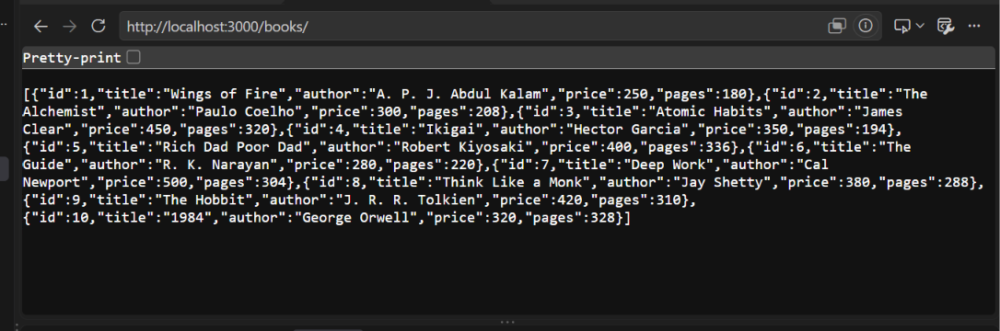
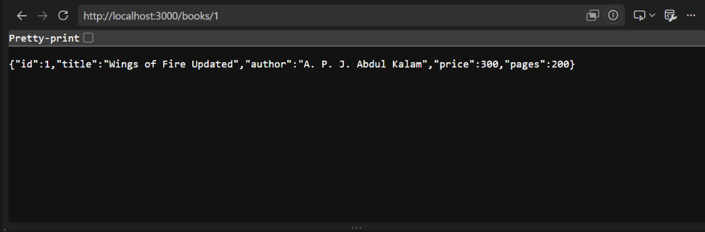
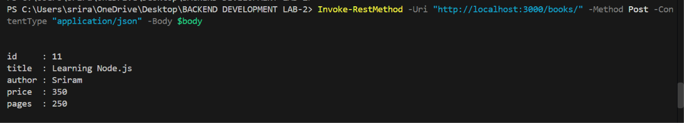
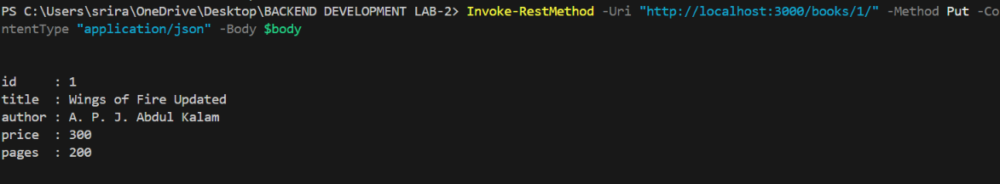
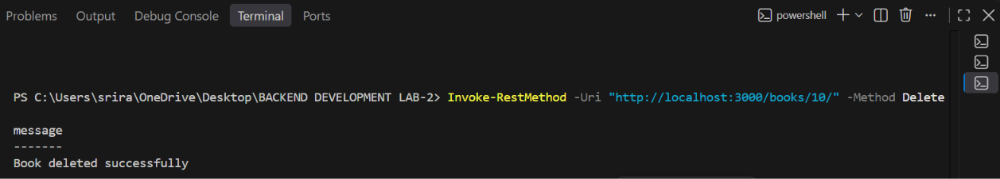

# Backend-Development-Fundamentals-lab-02

**Subject:** Backend Development Fundamentals  
**Year/Term:** Year II, Term II  
**University:** Aurora Deemed to be University  
**Faculty:** Mr. Joel Prashanth D

## Student Details

| Field | Details |
|---|---|
| Name | RAYABARAPU SRIRAM |
| Registration Number | 252U1R9136 |
| Section | S-26 |

## Project Objective

The objective of this lab is to understand how to create a backend application using Node.js and Express.js with an SQLite database. The project demonstrates CRUD operations: Create, Read, Update, and Delete. It uses REST API endpoints to add new books, retrieve book details, update existing records, and delete books from the database.

## Technologies Used

- Node.js
- Express.js
- SQLite (`sqlite` & `sqlite3`)
- JavaScript (CommonJS)
- npm
- PowerShell for API testing

## Project Folder Structure

```text
BACKEND DEVELOPMENT LAB-2/
├── server.js
├── database.js
├── seed.js
├── test.js
├── render.yaml
├── vercel.json
├── package.json
├── package-lock.json
├── .gitignore
├── books.db
├── README.md
└── screenshots/
    ├── get-all-books.png
    ├── get-single-book.png
    ├── post-book.png
    ├── put-book.png
    └── delete-book.png
```

*Note: The `screenshots/` folder contains verified API execution proofs. The database file `books.db` is initialized and populated with sample records by running the seed script.*

## Installation and Execution

### Prerequisites

- Node.js (v18, v20, v22, or v24) installed on the computer.
- npm installed with Node.js.
- Visual Studio Code or another code editor.

### Step 1: Install Dependencies

Open the terminal in the project directory and run:

```bash
npm install
```

### Step 2: Initialize the Database

Run the seed script:

```bash
npm run seed
```
*(or `node seed.js`)*

The script creates the SQLite database table `book` and inserts 10 sample book records if the table is empty.

### Step 3: Run Automated Tests

To verify that all 5 CRUD endpoints, validation checks, and error handlers are functioning correctly:

```bash
npm test
```

### Step 4: Start the Server

Run:

```bash
npm start
```
*(or `node server.js`)*

The server starts at:

```text
http://localhost:3000
```

Keep the terminal running while testing the API.

---

## Deployment Guide

### Option 1: Deploy to Render (Recommended for Express & SQLite)

Render is a long-running web application platform ideal for stateful Express.js servers with SQLite.

#### Automated Blueprint Deployment:
A `render.yaml` file is included in the project. Render automatically detects the configuration:
- **Build Command:** `npm install && npm rebuild sqlite3 --build-from-source && npm run seed`
- **Start Command:** `npm start`

#### Manual Dashboard Deployment:
1. Log in to [Render Dashboard](https://dashboard.render.com/) and click **New +** -> **Web Service**.
2. Connect your GitHub repository: `Backend-Development-Fundamentals-lab-02`.
3. Configure the service settings:
   - **Name:** `book-management-api`
   - **Region:** Any close region (e.g., Singapore or Oregon).
   - **Branch:** `main`
   - **Root Directory:** Leave **EMPTY** (so Render uses repository root).
   - **Runtime:** `Node`
   - **Build Command:** `npm install && npm rebuild sqlite3 --build-from-source && npm run seed`
   - **Start Command:** `npm start`
   - **Instance Type:** `Free`
4. Click **Deploy Web Service**.

> **Important — Why rebuild sqlite3 from source on Render?**  
> Render's Linux runtime uses Ubuntu 22.04 LTS (GLIBC 2.35). Prebuilt binaries in newer `sqlite3` releases can trigger `Error: /lib64/libm.so.6: version 'GLIBC_2.38' not found`. The build command `npm rebuild sqlite3 --build-from-source` compiles the binary directly against Render's system libraries, completely resolving the issue.

> **Database Persistence on Render:**  
> On Render's Free Tier, the filesystem is ephemeral (it resets on redeployment). To preserve SQLite data permanently across redeployments on Render:
> 1. Attach a **Render Persistent Disk** (e.g. mounted at `/var/data`).
> 2. Add an environment variable in Render: `DB_PATH=/var/data/books.db`.  
> The application automatically reads `process.env.DB_PATH` and persists data to that disk.

---

### Option 2: Deploy to Vercel (Serverless Backend)

1. Import the repository into Vercel.
2. The included `vercel.json` routes incoming requests to `server.js` using `@vercel/node`.
3. On Vercel, SQLite is stored in `/tmp/books.db` because Vercel serverless functions have a read-only filesystem except for `/tmp`.
4. *Note:* Serverless `/tmp` storage is ephemeral and resets between function cold starts.

---

## CRUD API Endpoints

| HTTP Method | Endpoint | Description | Expected Status |
|---|---|---|---|
| GET | `/` | API welcome message & endpoint directory | 200 OK |
| GET | `/books` | Retrieve all books | 200 OK |
| GET | `/books/:id` | Retrieve a book by ID | 200 OK |
| POST | `/books` | Add a new book | 201 Created |
| PUT | `/books/:id` | Update a book by ID | 200 OK |
| DELETE | `/books/:id` | Delete a book by ID | 200 OK |

*Note: All endpoints support both `/books` and `/books/`, as well as `:id` and `:bookId`.*

### Book Data Schema

Each book record contains:
- `id` (Integer, Primary Key, Auto-increment)
- `title` (Text, Required)
- `author` (Text, Required)
- `price` (Integer, Non-negative, Required)
- `pages` (Integer, Positive, Required)

---

## Testing the API

The API endpoints were tested using PowerShell in the Visual Studio Code terminal.

### 1. GET — Retrieve All Books

Request:

```text
GET http://localhost:3000/books/
```

The endpoint returns the available books in JSON format.

### 2. GET — Retrieve a Single Book

Request:

```text
GET http://localhost:3000/books/1/
```

The endpoint returns the details of the requested book.

### 3. POST — Add a New Book

Request:

```text
POST http://localhost:3000/books/
```

JSON body:

```json
{
  "title": "Learning Node.js",
  "author": "Sriram",
  "price": 350,
  "pages": 250
}
```

The endpoint adds the new book and returns its generated ID and details.

### 4. PUT — Update a Book

Request:

```text
PUT http://localhost:3000/books/1/
```

JSON body:

```json
{
  "title": "Wings of Fire Updated",
  "author": "A. P. J. Abdul Kalam",
  "price": 300,
  "pages": 200
}
```

The endpoint updates the selected book's details.

### 5. DELETE — Delete a Book

Request:

```text
DELETE http://localhost:3000/books/10/
```

The endpoint deletes the book with ID 10 and returns a success message. A subsequent request for the deleted book returns a 404 response.

---

## Screenshots

The following screenshots demonstrate the API operations performed during the lab.

### 1. GET — All Books



### 2. GET — Single Book



### 3. POST — Add a Book



### 4. PUT — Update a Book



### 5. DELETE — Delete a Book



---

## Problems Faced and Solutions

| Problem | Cause | Solution |
|---|---|---|
| Render `ENOENT: package.json` | Render Root Directory misconfiguration | Set Root Directory to empty in Render settings so commands execute at repository root. |
| Render SQLite `GLIBC_2.38 not found` | Prebuilt `sqlite3` binary built against GLIBC 2.38+ | Added `npm rebuild sqlite3 --build-from-source` to compile binary against host GLIBC. |
| Vercel `STATIC_BUILD_NO_OUT_DIR` | Vercel defaulted to static build without `vercel.json` | Added `vercel.json` configuring `@vercel/node` serverless runtime. |
| Handling missing book IDs | Non-existent or invalid ID requests | Implemented ID validation (400) and existence checks returning 404 JSON responses. |
| JSON error crashes | Malformed request body | Added Express error-handling middleware for JSON syntax errors. |
| SQLite database concurrency | Database file locks under traffic | Configured SQLite WAL mode (`PRAGMA journal_mode = WAL;`) and busy timeout (5000ms). |

## Learning Outcomes

- Understood backend development using Node.js and Express.js.
- Learned to connect an application to an SQLite database.
- Created and initialized a database table.
- Implemented GET, POST, PUT, and DELETE API endpoints.
- Practiced sending JSON data through HTTP requests.
- Learned to handle missing records using HTTP status codes.
- Implemented robust error handling middleware and input validation.
- Tested API functionality using automated tests and PowerShell.
- Configured production deployment settings for cloud hosting on Render.

## Git Hygiene

The `.gitignore` file contains:

```gitignore
node_modules/
.env
.vercel/
*.db-journal
*.db-wal
*.db-shm
*.log
```

Do not upload `node_modules`, passwords, API keys, or temporary files to GitHub.

## GitHub Repository

**Repository:** [Backend-Development-Fundamentals-lab-02](https://github.com/sriramrayabarapu/Backend-Development-Fundamentals-lab-02)

## Conclusion

This lab provided practical experience in developing a backend application using Node.js, Express.js, and SQLite. The project successfully demonstrated creating, reading, updating, and deleting book records through REST API endpoints. It improved my understanding of database connectivity, HTTP methods, JSON responses, error handling, automated testing, and backend application deployment.
